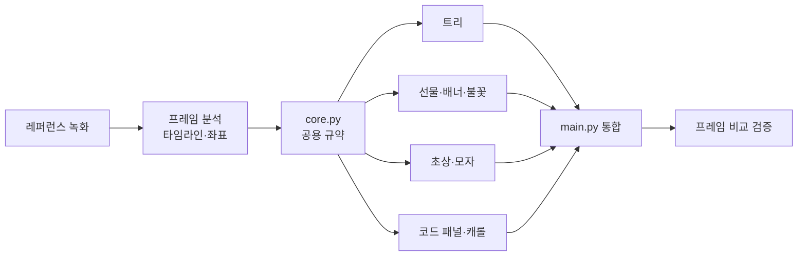

# ASCII Christmas Tree

화면에 보이는 모든 것이 글자인 크리스마스 트리 애니메이션입니다.
인스타그램 [릴스](https://www.instagram.com/p/DfviMzevtMx/) 한 편을 소스 없이 결과 화면만 보고 분석해서 같은 장면을 다시 만들었습니다. AI 코딩 에이전트로 리버스 엔지니어링을 얼마나 빠르고 정확하게 할 수 있는지 확인하려는 프로젝트입니다.


## 요약

| 항목 | 내용 |
|---|---|
| 입력 | 13초짜리 화면 녹화 1개, 릴스 설명글 |
| 소요 시간 | 녹화 파일을 넘긴 시점부터 완성 영상 커밋까지 약 10분 |
| 도구 | Claude Code |
| 모델 | 설계·통합: Claude Fable 5.2 / 구현: Claude Opus 하위 에이전트 3개 병렬 |
| 결과물 | Python 945줄, 1080×1920 30fps 영상, 합성 캐롤 |
| 렌더링 | 396프레임 76초 (프레임당 약 0.2초) |

## 분석 과정

원본 소스는 공개되어 있지 않아 영상에서 관찰할 수 있는 것만 근거로 삼았습니다.

1. **단서 수집** — 설명글에서 글자 3,000개, 원뿔 배치, 55×30 얼굴 격자, numpy와 Pillow 사용이라는 사실을 확인했습니다.
2. **프레임 분해** — ffmpeg로 녹화 영상을 1초 간격으로 잘라 한 장에 나란히 놓고, 장면이 바뀌는 시점을 표로 정리했습니다.
3. **좌표 측정** — 프레임에서 트리 꼭대기, 바닥 반지름, 초상 원의 중심과 반지름을 픽셀로 재서 1080×1920 기준 상수로 옮겼습니다. 화면 수치 표시의 회전각과 시간으로 회전 속도(초당 약 31°)를 계산했습니다.
4. **출력 방식 추정** — 처음에는 터미널 격자에 찍는 방식으로 만들었는데 원본보다 글자 밀도가 낮았습니다. 원본은 글자를 격자 칸이 아니라 픽셀 위치에 그린다고 판단해 Pillow 렌더링으로 바꿨습니다. 첫 버전은 `tree.py`에 남겨 두었습니다.

## 작업 방식



- **규약 먼저** — 화면 크기, 색, 타임라인, 배치 좌표를 `core.py` 한 곳에 정하고, 모든 장면을 `draw(d, t)` 함수 하나로 통일했습니다. 파일이 서로 겹치지 않아 에이전트 3개가 동시에 작업할 수 있었고, 각각 85~167초에 끝났습니다.
- **스스로 확인하게 하기** — 에이전트마다 자기 장면을 PNG로 뽑아 직접 보고 고친 뒤 넘기도록 했습니다. 통합 단계에서 고친 것은 별 비율과 코드 패널 스크롤 속도 두 가지였습니다.
- **역할 분담** — 사람은 레퍼런스 선정, 방향 결정(구현 언어, 에이전트 구성과 모델), 결과 확인과 승인을 맡았습니다. 분석, 설계, 구현은 AI가 했습니다.

## 검증

- 장면이 시간 `t`만 받는 함수라 같은 시점은 항상 같은 그림이 나옵니다. 영상 전체를 뽑지 않고 `--frame 6.0`처럼 한 장만 그려 원본의 같은 시점과 나란히 비교했습니다.
- 캐롤은 사람이 듣기 전에 길이, 최대 음량, 음표 25개의 주파수를 FFT로 확인했습니다.

## 원리

트리는 글자 3,000개입니다. 글자마다 원뿔 위의 3D 좌표를 하나씩 갖고 있고, 매 프레임 세 단계를 거칩니다.

1. **회전** — 모든 좌표를 Y축으로 조금씩 돌립니다.
2. **투영** — 3D 좌표를 화면의 2D 위치로 옮깁니다.
3. **깊이 표현** — 뒤쪽 글자는 어둡게, 앞쪽 글자는 밝게 칠하고 뒤에서부터 차례로 찍습니다.

얼굴도 같은 발상입니다. 사진을 55×30 격자로 줄이고, 칸의 밝기에 따라 듬성한 글자(`.`)부터 빽빽한 글자(`@`)까지 골라 넣습니다.

## 실행

```bash
python -m venv .venv
.venv\Scripts\pip install -r requirements.txt
.venv\Scripts\python main.py              # out/christmas_tree.mp4 생성 후 재생 (ffmpeg 필요)
.venv\Scripts\python main.py --frame 6.0  # 6.0초 시점 한 장만 PNG로 저장
.venv\Scripts\python tree.py              # 터미널에서 도는 첫 버전
```

`assets/face.jpg`에 사진을 넣으면 왼쪽 위 초상이 그 사진으로 바뀝니다. 없으면 기본 얼굴이 나옵니다.

## 구조

| 파일 | 역할 |
|---|---|
| `core.py` | 화면 크기, 색, 타임라인, 공용 함수 |
| `tree_fx.py` | 트리, 나선 장식, 전구, 별, 눈 |
| `gifts_fx.py` | 선물 상자, 배너, 불꽃놀이 |
| `portrait_fx.py` | 얼굴 아스키 변환, 산타 모자 |
| `panel_fx.py` | 아래쪽 코드 패널 (이 프로젝트의 소스가 그대로 흐릅니다) |
| `audio.py` | 캐롤 합성 |
| `main.py` | 프레임을 합쳐 영상으로 인코딩 |

## 판단 기록

| 상황 | 결정 |
|---|---|
| 터미널 출력으로는 원본의 밀도가 나오지 않음 | 픽셀 단위 렌더링으로 전환, 터미널 버전은 기록으로 보존 |
| 원본 배경 음악은 저작권이 있는 곡 | 저작권이 만료된 Jingle Bells(1857)를 numpy로 직접 합성 |
| 초상에 개인 사진이 들어감 | `assets/`를 저장소에서 제외, 사진이 없어도 동작하는 기본 얼굴 제공 |
| 소스 835줄을 13초에 다 흘리면 읽을 수 없음 | 코드 패널 스크롤을 초당 10줄로 고정 |

## 한계

- 원본과 장면 구성과 타이밍은 맞췄지만 글자 배치와 색은 같지 않습니다.
- 55×30 격자라 조명이 고른 사진은 이목구비가 흐리게 나옵니다. 명암이 뚜렷한 사진이 잘 나옵니다.
- 아이디어와 장면 구성의 출처는 위 릴스입니다.
