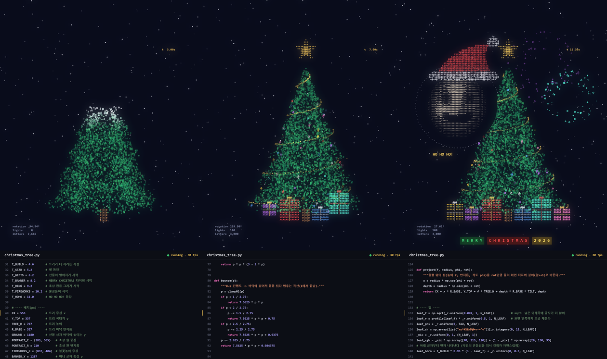

<div align="center">

# ASCII Christmas Tree

화면에 보이는 모든 것이 글자인 크리스마스 트리 애니메이션




</div>

인스타그램 [릴스](https://www.instagram.com/p/DfviMzevtMx/) 한 편을 소스 없이 결과 화면만 보고 분석해서, 바이브 코딩으로 다시 만든 리버스 엔지니어링 프로젝트입니다.

<div align="center">

| 입력 | 소요 시간 | 에이전트 | 코드 |
|:---:|:---:|:---:|:---:|
| 13초 화면 녹화 1개 | 약 10분 | 3개 병렬 | Python 약 950줄 |

</div>

> 소요 시간은 녹화 파일을 넘긴 시점부터 완성 영상을 커밋한 시점까지입니다.

## 어떻게 만들었나

| 단계 | 한 일 | 담당 |
|:---:|---|---|
| 1 | 녹화 영상을 1초 간격 프레임으로 잘라 장면 순서와 좌표를 측정 | Claude Fable 5.2 |
| 2 | 모든 장면을 `draw(d, t)` 함수 하나로 통일하는 규약 작성 | Claude Fable 5.2 |
| 3 | 선물과 불꽃, 초상과 모자, 코드 패널과 캐롤을 동시에 구현 | Claude Opus 에이전트 3개 |
| 4 | 한 프레임씩 뽑아 원본의 같은 시점과 비교하며 통합 | Claude Fable 5.2 |

사람은 레퍼런스 선정, 구현 언어와 에이전트 구성 결정, 결과 확인과 승인을 맡았습니다.

## 원리

- **트리**: 글자 3,000개가 원뿔 위의 3D 좌표를 하나씩 갖습니다. 매 프레임 회전시켜 화면에 투영하고, 뒤쪽 글자는 어둡게 앞쪽 글자는 밝게 칠합니다.
- **얼굴**: 사진을 55×30 격자로 줄이고, 칸의 밝기에 따라 `.`부터 `@`까지 글자를 골라 넣습니다.

## 실행

```bash
python -m venv .venv
.venv\Scripts\pip install -r requirements.txt
.venv\Scripts\python main.py       # 영상 생성 후 재생 (ffmpeg 필요)
.venv\Scripts\python terminal.py   # 터미널에서 바로 재생 (Ctrl+C로 종료)
```

`assets/face.jpg`에 사진을 넣으면 초상이 그 사진으로 바뀝니다.

<details>
<summary>파일 구조</summary>

| 파일 | 역할 |
|---|---|
| `core.py` | 화면 크기, 색, 타임라인 |
| `tree_fx.py` | 트리, 장식, 전구, 별, 눈 |
| `gifts_fx.py` | 선물, 배너, 불꽃놀이 |
| `portrait_fx.py` | 얼굴 변환, 산타 모자 |
| `panel_fx.py` | 코드 패널 |
| `audio.py` | 캐롤 합성 |
| `main.py` | 영상 인코딩 |
| `terminal.py` | 터미널 버전 |

</details>

<details>
<summary>출처와 저작권</summary>

- 아이디어와 장면 구성은 위 릴스에서 가져왔고 코드는 새로 작성했습니다.
- 음악은 저작권이 만료된 Jingle Bells를 코드로 합성했습니다.

</details>
